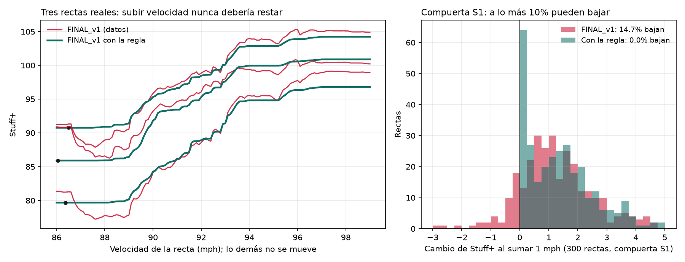
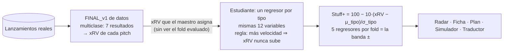

# 15 · Integración de los modelos finales de datos (Stuff+ `FINAL_v1` y Location+ `L3`)

**Fechas:** 19 y 20 de octubre de 2026 · **Rama:** `feat/final-models` · **Fuente:** rama de datos
`feat/stuff-plus-mlflow`, commit `19966f3` · **MLflow:** `superestela/A-target/final-folds`,
`superestela/A-target/final-monotone`, `superestela/B-location/final-folds`,
`superestela/product/integration`.

> **En una línea:** los dos modelos de datos corren dentro del producto, por la API y por la costura
> única (ADR 0010), y reproducen el cálculo de datos (fuera de fold contra fuera de fold: r 0.981
> en Stuff+ y 0.9986 en Location+). En pantallas se publica **`FINAL_v1` con una regla añadida: más
> velocidad nunca resta Stuff+** (modelo `1.1.0+19966f3`). Pasa las compuertas S1–S6, cosa que
> `FINAL_v1` tal cual no lograba.

> **⚠️ HALLAZGO IMPORTANTE PARA EL REPORTE FINAL — §3.** El modelo elegido por datos, con buena
> calibración, decía que en 14.7% de las rectas reales **lanzar 1 mph más rápido empeora el pitch**.
> Lo encontró una prueba de sentido común del producto (compuerta S1). La solución conserva el
> modelo de datos y su precisión, y le añade la regla: empata o mejora a `FINAL_v1` en las métricas
> de datos, con 0% de violaciones. Es el mejor ejemplo del proyecto de por qué un modelo no se
> publica solo por su métrica de entrenamiento.

---

## 1. Qué entregó datos

| Pieza | Stuff+ `FINAL_v1` | Location+ `L3_loc_count_hand` |
|---|---|---|
| Qué predice | 7 resultados de un swing: Whiff, Foul, Weak (<71 mph), Out, Single, XBH, HomeRun | 8 resultados de cualquier lanzamiento: Ball, StrikeCalled, Whiff, Foul, Out, Single, XBH, HomeRun |
| Variables | 13: forma al soltar (espejada al lado del brazo), `same_hand` y 3 diferenciales contra la recta principal | 5: altura y lado en el plato (vista del cátcher, sin espejar), bolas, strikes, `same_hand` |
| Modelos | 6 boosters XGBoost, uno por tipo | 6 boosters XGBoost, uno por tipo |
| Valor en carreras | Uno por clase (`rv_values.csv`) | **Por clase y conteo** (tabla 8×4×3) |
| Escala | 100 − 10·(xRV − μ_tipo)/σ_tipo, con μ y σ fuera de fold | La misma fórmula; **μ y σ no se entregaron** |
| Neutral a la mano | Sí: promedia los dos lados del bateador con el peso del entrenamiento | No: el enfrentamiento es parte de dónde debe ir el pitch |

Tipos cubiertos: Four-Seam, Sinker, Slider, Changeup, Curveball y Cutter. **No hay Splitter ni
Sweeper**: la API responde `unsupported_pitch_type`.

### Por qué `FINAL_v1` y no otro candidato

Todos los candidatos tienen estado `candidate` en MLflow y las seis etiquetas obligatorias. Estas
métricas comparan runs con targets distintos (el log-loss no sirve para eso):

| Run | Target | Calibración | Split-half | r whiff siguiente | r carreras siguientes* | Experimento natural (S6) |
|---|---|---|---|---|---|---|
| **FINAL_v1** | swing_cq | **0.830** | **0.956** | **0.296** | **−0.132** | **0.193** |
| FIN_B_all8 | all8 | 0.785 | 0.951 | 0.248 | −0.108 | 0.176 |
| FIN_C_allcq | all_cq | 0.824 | 0.954 | 0.260 | −0.114 | 0.185 |

\* `delta_run_exp` es desde el lado del bateador: más negativo = mejor. La r de las carreras de un año
contra las del siguiente es 0.12, así que el Stuff+ anticipa las carreras tan bien como ellas mismas.

## 2. Los choques con el producto y cómo se resolvieron

1. **Arsenal.** `FINAL_v1` mide cada pitch contra la recta principal del lanzador en esa temporada y
   ese entorno, y el contrato rechazaba `uses_arsenal=True`. Se portó `_fb_diffs` a
   `models/features/arsenal.py`:
   - La familia de rectas es Four-Seam, Sinker, TwoSeam y OneSeam, **sin Cutter**, distinta de
     `core.arsenal`. Sin recta, la referencia es la más rápida.
   - Se calcula antes de filtrar filas, como en el entrenamiento. La paridad con la función de datos
     es exacta (§5).
   - **Sin arsenal conocido, el pitch no se puntúa;** nunca se rellena con cero. En el Simulador sale
     la razón `missing_arsenal` (modo laboratorio).
   - **Con arsenal conocido pero una referencia sin la medida** (una sola Four-Seam sin IVB), el
     diferencial es NaN y el modelo lo toma como faltante, igual que en el entrenamiento. Rechazarlo
     borraba la tarjeta de pitcher_01099 2025.
2. **Escala por tipo.** `ScaleSpec.by_type` guarda (μ, σ) por tipo e `implied_xrv()` invierte
   Stuff+ a xRV con el tipo correcto. Lo usan S5/S7, el impuesto proyectado y el Plan (§6). Con v0,
   sin `by_type`, da exactamente lo mismo que antes.
3. **Bandas.** El contrato exige al menos 2 draws, y datos entregó un solo booster por tipo.
   Producto re-entrenó con **el código, la configuración y la semilla de datos**
   (`scripts/retrain_final_folds.py`, registrado en MLflow) para conservar los 5 boosters de la
   validación cruzada. Fuera de fold contra fuera de fold, reproduce sus tablas por lanzador con
   r 0.981 en `FINAL_v1` y 0.9986 en L3.
   - La diferencia de `FINAL_v1` viene de que datos lo entrenó sobre una versión del dataset con
     unas 850 rectas menos (215 998 contra 216 850). Es una pregunta abierta para datos.
4. **Location+ no tenía costura.**
   - Tiene su propio modelo (`models/location/final.py`), su propia validación y su propio vector.
   - La tabla 8×4×3 se reconstruyó del dataset con la lógica de datos portada (`models/outcomes.py`;
     contra su `rv_values.csv`, la diferencia máxima es 1e-16).
   - La escala es la fuera de fold del re-entrenamiento.

---

## 3. ⚠️ Hallazgo importante: la recta que pierde valor al acelerar

### 3.1 Qué encontramos

El producto no publica un Stuff+ en el Simulador hasta que pasa compuertas de sentido común
(ADR 0007). La **S1** pregunta algo que cualquier coach da por hecho:

> *Si a una recta real le subo 1 mph y no le toco nada más, ¿su Stuff+ sube?*

Se prueba sobre 300 rectas reales a nivel del mar, y se tolera que hasta el 10% baje (ruido). Con
`FINAL_v1`:

- **En promedio sí sube:** +1.3 puntos por mph. El modelo «entiende» que la velocidad ayuda.
- **Pero en 14.7% de las rectas baja**, un promedio de 0.7 puntos.
- No es al azar; se concentra en los extremos:

| Velocidad de la recta | % que pierde Stuff+ al subir 1 mph |
|---|---|
| menos de 89.2 mph | **36%** |
| 89.2 – 91.0 | 0% |
| 91.0 – 92.5 | 3% |
| 92.5 – 94.2 | 12% |
| más de 94.2 mph | **22%** |

*(`analysis/outputs/speed_rule.json`; el reporte las cita por `report/claims.toml`, ids `speed-rule-*`.)*



*Izquierda: tres rectas reales con todo fijo salvo la velocidad. En rojo `FINAL_v1`: entre 86 y 88
mph su Stuff+ baja hasta 4 puntos al acelerar. En verde, el mismo modelo con la regla: sigue a
`FINAL_v1` donde este tiene sentido y no baja nunca. Derecha: el cambio de Stuff+ al sumar 1 mph en
las 300 rectas de la compuerta; con `FINAL_v1` el 14.7% queda a la izquierda del cero, con la regla
ninguna. (`scripts/figure_speed_rule.py`; la misma figura está en MLflow,
`superestela/A-target/final-monotone`, run `figure-speed-rule`).*

### 3.2 Por qué importa

- **En la demo:** un scout abre el Simulador con un lanzador de 95 mph, sube la velocidad a 96 y el
  Stuff+ baja. La herramienta pierde la confianza en cinco segundos, y con razón.
- **En el fondo:** un modelo puede estar bien calibrado en promedio y aun así decir algo físicamente
  absurdo en una parte del espacio. Las métricas de entrenamiento no lo ven; una prueba de sentido
  común, sí.

### 3.3 Por qué pasa

- `FINAL_v1` está hecho de árboles de decisión. Un árbol parte la velocidad en escalones («si va a más
  de 94.2…») y aprende cada escalón con los datos que caen ahí.
- En los extremos hay pocas rectas, así que algunos escalones aprenden ruido: el de arriba sale un
  poco peor que el de abajo.
- **No se le puede decir al modelo de datos que «más rápido nunca es peor».** XGBoost permite esa
  restricción («monótona»), pero `FINAL_v1` es multiclase. Predice 7 resultados y el Stuff+ sale de
  mezclarlos con sus valores en carreras. La regla es sobre la mezcla, no sobre ninguna clase: más
  velocidad debería subir el whiff *y* bajar los jonrones, y una restricción aplica la misma
  dirección a todas las clases.

### 3.4 Lo que probamos y no funcionó

| Intento | S1 (violaciones) | Por qué no |
|---|---|---|
| `FINAL_v1` con un solo booster | 16.7% | Escalones de un solo modelo |
| 5 boosters por fold (promedio) | 13.7% | Suaviza S3, pero S1 no es ruido |
| 20 boosters (4 semillas × 5 folds) | 14.7% | Más promedio no cambia lo que el modelo aprendió |
| Parámetros más suaves de datos (`shallow`, `slow`) | 13.0%, 14.3% | La misma estructura |
| Mezclar: tarjetas con `FINAL_v1`, Simulador con v0 | v0 pasa S1, pero **S4 cae a r 0.57** | La Ficha y el Simulador se contradicen para el mismo pitch (6.8 puntos) |
| Redefinir S1 (acelerar solo ese pitch respecto a su arsenal: 8.3%) | — | **Descartado sin probarlo en pantallas:** cambiar la prueba después de ver el resultado es mover la portería |

### 3.5 La solución: destilar `FINAL_v1` con la regla

La idea, en palabras: **el modelo de datos enseña y un segundo modelo aprende de él, con una regla
que no puede romper.**



Paso a paso (`scripts/distill_monotone.py`, `models/stuff/monotone.py`):

1. **El maestro es `FINAL_v1` tal cual lo entrenó datos:** mismas variables, mismo espejo, mismos
   diferenciales contra la recta, mismo recorte. Para cada lanzamiento da su xRV (carreras esperadas
   del resultado).
2. **El estudiante** es un regresor XGBoost por tipo de pitch. Usa las mismas variables (menos
   `same_hand`, porque el maestro ya es neutral a la mano) y los parámetros `base` de datos. Aprende
   a reproducir el xRV del maestro con **`monotone_constraints = −1` en la velocidad**: con todo lo
   demás fijo, más velocidad nunca puede subir el xRV, así que nunca baja el Stuff+.
3. **Por qué ahora sí cabe la regla:** el estudiante predice directamente el xRV, que es la cantidad
   sobre la que es la regla. Ya no hay siete clases que mezclar.
4. **Bandas:** se entrena un estudiante por cada fold de lanzadores (5). Los cinco son los draws: su
   promedio es el Stuff+ y su dispersión la banda al 95%.
5. **Escala:** 100 y una desviación por tipo salen del xRV fuera de fold de los estudiantes, igual que
   datos definió la de `FINAL_v1`.

### 3.6 La trampa que evitamos: un resultado demasiado bueno

El primer intento entrenó al estudiante con las predicciones fuera de fold del maestro, y **salió
mejor que el maestro en todo**: xRV contra carreras observadas 0.435 contra 0.374, y carreras de la
temporada siguiente −0.213 contra −0.148. Un modelo que solo imita a otro no debería superarlo así.

La causa era una fuga. Esas predicciones venían de boosters que sí habían visto a los lanzadores del
fold que luego se evaluaba, así que la información de su resultado llegaba de vuelta por los vecinos.

**La versión publicada la evita:** el estudiante del fold k aprende solo del booster maestro que
nunca vio el fold k, y solo sobre los otros folds. Sus predicciones en el fold k son fuera de fold
dos veces.

### 3.7 Resultados

**Contra `FINAL_v1`, con la evaluación de datos (`evaluate_scored`) y fuera de fold los dos:**

| Métrica | `FINAL_v1` | Con la regla | |
|---|---|---|---|
| Calibración (pendiente de deciles) | 0.808 | **0.841** | mejor |
| Calibración en altitud extrema | 0.705 | **0.761** | mejor |
| Split-half (estabilidad) | 0.950 | **0.953** | igual |
| r con whiff de la temporada siguiente | 0.291 | **0.296** | igual |
| r con carreras de la temporada siguiente | −0.134 | −0.132 | igual |
| r xRV contra carreras observadas | 0.361 | **0.365** | igual |
| r xRV contra carreras del año siguiente | 0.191 | 0.188 | igual |
| Experimento natural (S6) | 0.188 | **0.194** | igual |

Coincidencia con `FINAL_v1`: **r 0.994** por lanzador, temporada y tipo, y de 0.971 a 0.981 por
lanzamiento según el tipo.

**Las compuertas del producto, publicadas en `analysis/outputs/simulator_validation.json`:**

| Compuerta | v0 (antes) | `FINAL_v1` (20 boosters) | **Con la regla (publicado)** |
|---|---|---|---|
| S1 · +1 mph sube el Stuff+ (≤10%) | ✅ 9.3% (+1.79) | ❌ 14.7% (+1.29) | ✅ **0%** (+1.41) |
| S2 · zurdo espejado | ✅ 0.0 | ✅ 0.0 | ✅ 0.0 |
| S3 · saltos por paso de 0.1 (p99 ≤ 1.5) | ✅ 1.23 | ✅ 1.10 | ✅ **0.97** |
| S4 · Simulador contra Radar (r ≥ 0.9) | ✅ 0.951 | ✅ 0.925 | ✅ **0.942** |
| S5 · calibración por deciles | ✅ | ✅ | ✅ |
| S6 · experimento natural (r > 0) | ✅ 0.144 | ✅ 0.222 | ✅ **0.218** |
| S7 · contra el nulo por conteo | ❌ | ❌ | ❌ (cuenta + modelo sí le gana al nulo: 0.21723 contra 0.21747) |

S1–S4 deciden si el Simulador muestra Stuff+: con la regla, lo muestra. Ninguno de los modelos
gana S7 por sí solo, ni v0 ni el de datos, y se reporta como sale.

### 3.8 El costo, dicho con honestidad

- **En los extremos la regla aplana en vez de subir.** Donde `FINAL_v1` bajaba, el estudiante se
  queda plano: 64 de las 300 rectas cambian menos de 0.25 puntos al sumar 1 mph (figura, derecha).
  Es la respuesta prudente donde hay pocos datos: no inventa una subida, solo no permite una bajada.
- **La regla es solo de velocidad.** Es la que el producto prueba y la que un coach exige. Otras
  (más IVB en una recta) no se impusieron, porque no hay compuerta que las respalde.
- **El modelo no lee la densidad del aire** (`FINAL_v1` tampoco). En el Simulador, todo el Δ por
  altitud viene de cuánto se encoge el pitch, y la pantalla lo dice con esas palabras.
- **El Stuff+ de pitcher_00069 2025, el ejemplo del prototipo, cambia de historia.** Con v0 su slider
  aguantaba la altura (−1.7); con el modelo final la que menos pierde es la curva (−6.6), y pasarle
  uso no compensa. El prototipo y el deck se actualizan con estas cifras.

### 3.9 Cómo se reproduce

```bash
DB=../superestela-datos/mlFlow/mlflow.db
NB=../superestela-datos/notebooks/experimentos_stuff.py
uv run python scripts/retrain_final_folds.py --notebook $NB --tracking-db $DB          # folds de datos
for s in 43 44 45; do uv run python scripts/retrain_final_folds.py --notebook $NB --tracking-db $DB --runs FINAL_v1 --seed $s; done
uv run python scripts/build_final_models.py --seeds 43 44 45                            # maestro
(cd scripts && uv run python distill_monotone.py --notebook ../$NB --tracking-db ../$DB) # estudiante
uv run python scripts/build_final_models.py --seeds 43 44 45                            # empaqueta los dos
uv run python scripts/regenerate.py --model artifacts/stuff_plus_final_v1_monotone.joblib --publish
uv run python scripts/log_integration_to_mlflow.py --tracking-db $DB
uv run python scripts/figure_speed_rule.py --tracking-db $DB
```

En MLflow:

- `superestela/A-target/final-monotone` → run `FINAL_v1_monotone`: métricas del maestro y del
  estudiante y los 30 regresores. Run `figure-speed-rule`: la figura y S1 de los dos.
- `superestela/product/integration` → run `product-stuff_plus_final_v1_monotone`: las 7
  compuertas, la coincidencia con datos y el veredicto.

---

## 4. Cómo se usa

`artifacts/data-runs/` se llena copiando de la rama de datos `models/`, `config.json`,
`rv_values.csv`, `metrics.json` y `pitcher_table.csv` de cada run, más `runValues.csv` y
`SOURCE_COMMIT`. Nada de eso entra a git (CONVENTIONS §8.4). Los comandos están en §3.9.

La API sirve por defecto el modelo publicado (`artifacts/stuff_plus_final_v1_monotone.joblib`). Si no
está en disco, como en un clon nuevo, sirve el puente v0 y dice que no pasó por las compuertas.

**`POST /api/v1/pitches/score`** recibe lanzamientos con los nombres del front (`releaseSpeed`,
`plateSide`, `balls`…) y, opcionalmente, el `arsenal` o `pitcherId`/`year`/`environment`:

- Cada modelo valida **sus** columnas. Stuff+ necesita las 10 de forma más el arsenal. Location+
  necesita `pitchType`, `pitcherHand`, `batterHand`, `plateHeight`, `plateSide`, `balls` y
  `strikes`.
- Si ningún lanzamiento trae una columna obligatoria, responde 422 con el modelo y las columnas. Si
  solo le falta a algunos, cada uno trae `status: missing_features` y `missing: [...]`.
- Las seis variables opcionales de análisis (`altOrd`, `totalBreak`, `movePerRpm`, `vaaEst`,
  `locAbsSide`, `locDistCenter`) vienen aparte en `analysis`. Ningún score las lee.
- `stuffModel` y `locationModel` dicen qué run contestó, por qué se eligió y las métricas de los
  candidatos.

## 5. Verificación

| Prueba | Resultado | ¿Pasa? |
|---|---|---|
| Valores en carreras reconstruidos contra `rv_values.csv` de datos (ambos runs) | diferencia máx. 1e-16 | ✅ |
| Diferenciales contra la recta contra `_fb_diffs` de datos, 635 002 filas | diferencia 0.0, 0 NaN distintos | ✅ |
| Re-entrenamiento contra datos, fuera de fold contra fuera de fold, por lanzador, año y tipo | `FINAL_v1` r 0.981 · L3 r 0.9986 | ✅ |
| Log-loss fuera de fold del re-entrenamiento contra el de datos, por tipo | iguales al tercer decimal (Four-Seam 1.5034 contra 1.5034) | ✅ |
| Location+ servido contra `L3/pitcher_table.csv` | r 0.991; mismas 624 674 filas | ✅ |
| API real contra cálculo directo, 1 296 lanzamientos de un zurdo | diferencia 0.0 | ✅ |
| Errores de la API real: columna ausente, Splitter, sin arsenal | 422 con `plateSide`; `unsupported_pitch_type`; `missing_arsenal` | ✅ |
| Las 7 compuertas con el modelo publicado | S1–S6 ✅, S7 ❌ (como v0) | ✅ |
| pytest, mypy estricto, ruff, web (lint, tipos, 221 pruebas) | todo verde | ✅ |

## 6. Qué cambió en pantallas

- **Todas las cifras de Stuff+** (Radar, Ficha, Plan, Plantel, Despliegue, Simulador, Traductor) salen
  del modelo publicado, con banda real. El Simulador y la Ficha coinciden (S4 r 0.942).
- **El Plan habla en carreras.** Si un cambio de uso compensa, dice cuántas carreras por 9 entradas en
  altitud extrema ahorra. Cada lanzamiento movido vale el xRV de su propio tipo (`domain/runBridge.ts`).
- **La ubicación de la Ficha** (mapas y lectura «¿sobrecompensa?») cuenta los mismos lanzamientos que
  la cabecera, y el whiff igual que la tabla de resultados.
- **Despliegue:** el orden en casa y de gira correlaciona 0.786 con el modelo final (0.638 con v0). El
  cambio mediano es de 30.75 posiciones y 5 de los 10 mejores cambian.
- **El recorrido de pantallas del 20 de octubre** encontró 14 problemas visibles. Se corrigieron
  todos (merge «the fixes from the screen audit»), menos los que dependían del modelo, que este
  documento resuelve. Entre ellos, todo «±» es ahora la banda al 95%, con lo que la tarea 5 de
  docs/08 queda cerrada.

## 7. Qué falta

1. **Datos: confirmar la versión del dataset de `FINAL_v1`** (unas 850 rectas menos que la nuestra) y
   mandar la base `mlflow.db` posterior al re-entrenamiento de L3.
2. **Datos: revisar la regla de velocidad.** Si prefieren entrenarla ellos, el estudiante es un
   regresor por tipo con `monotone_constraints` sobre `RelSpeed`. Todo está en
   `scripts/distill_monotone.py`.
3. **Su rama no se fusiona:** sube 95 CSV por lanzador y los modelos (CONVENTIONS §8.4).
4. **Location+ en pantalla.** Hoy llega por la API. Debe presentarse como **descriptivo** («cómo
   ubicó»), no predictivo: split-half 0.53, r con las carreras siguientes ≈ 0, y la altitud no lo
   mueve.
5. **Prototipo y deck:** actualizar el ejemplo de pitcher_00069 (§3.8) y las cifras de Despliegue.
6. **Splitter y Sweeper** no tienen modelo.
